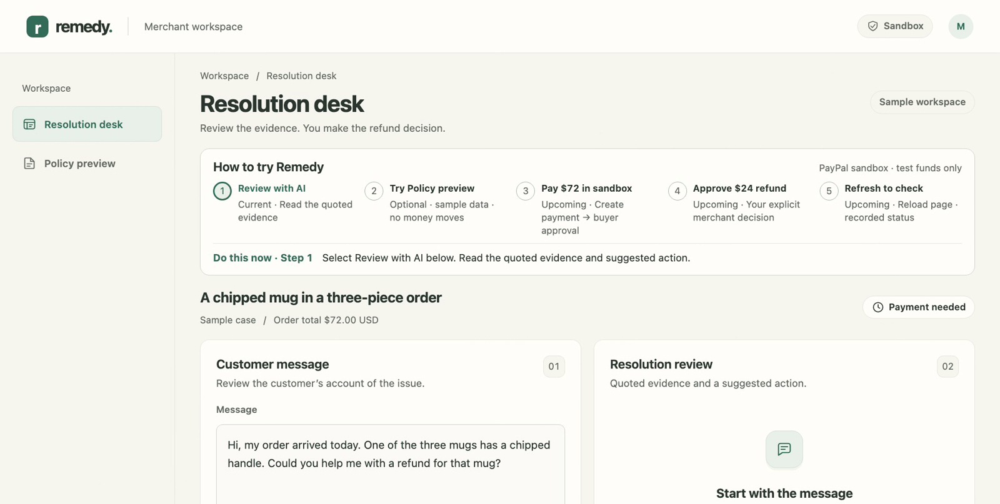
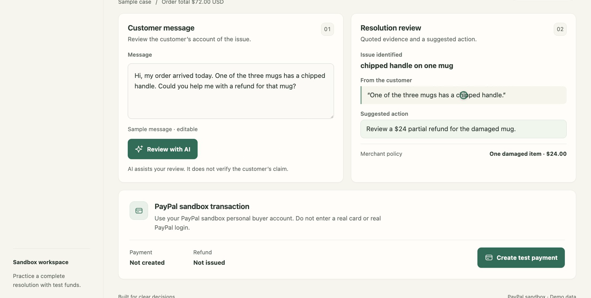
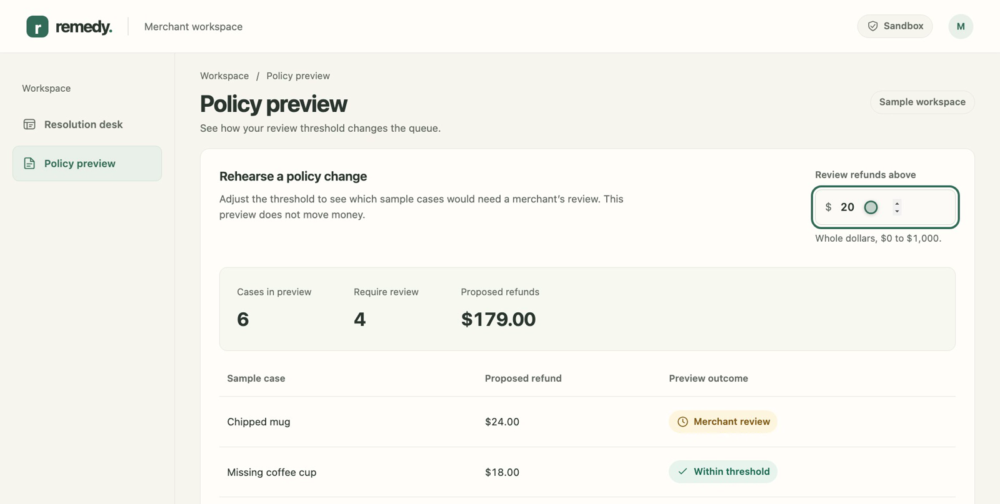
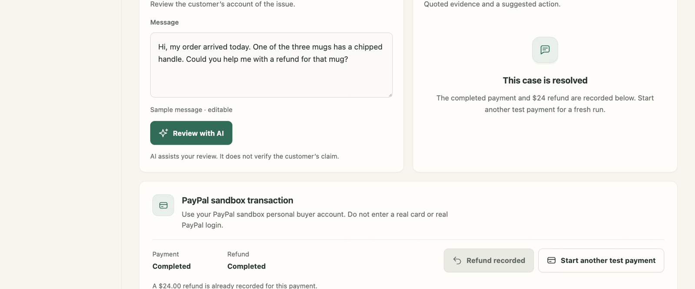
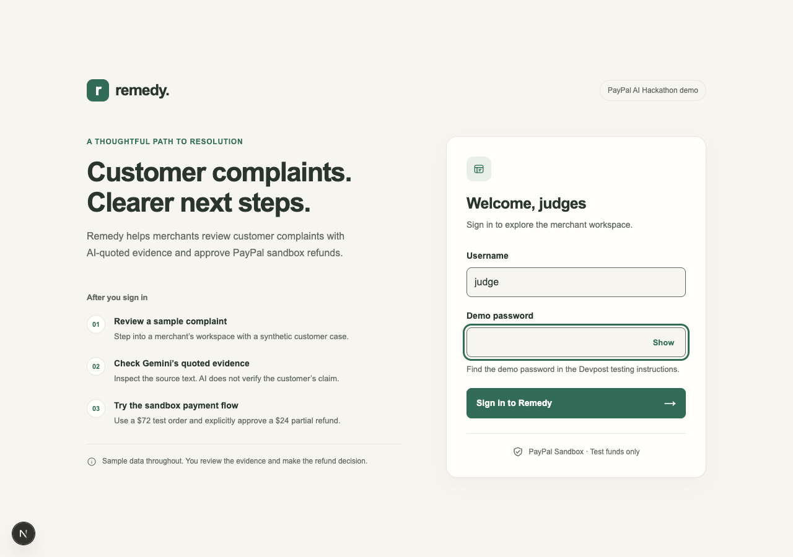

# Remedy

**Review the evidence. Approve the refund.**

Remedy is a merchant workspace built for the [PayPal AI Hackathon](https://paypalaihackathon.devpost.com/).
It puts a customer's message, an AI suggestion with the evidence behind it, and the PayPal
transaction in one place. Everything runs against the **PayPal sandbox** with synthetic data and
test funds.



- **Live sandbox demo:** https://remedy-oyr0.onrender.com/ (sign in as `judge`; the password is in the Devpost testing instructions)
- **Demo video:** linked from the Devpost entry
- **License:** [MIT](LICENSE)

## What it does

A small merchant reads *"One of the three mugs arrived chipped"* and has to work out what
happened, what is fair, and how to carry it out. Remedy:

1. **Reviews the message with Gemini.** The model returns the issue, a short quote from the
   customer's own words, and a suggested next step. The server checks that the quote appears
   **word for word** in the original message, so the merchant can see what the suggestion is based
   on. It does not verify damage or the customer's claim, and the AI has no authority over payments.
2. **Lets the merchant decide.** A fixed **$24** partial refund on a **$72** sandbox order
   (three $24 mugs) requires an explicit merchant confirmation.
3. **Records what PayPal returns.** Capture and refund statuses come from PayPal. A refund is shown as
   complete only when PayPal reports it as completed.
4. **Previews policy changes.** A separate, clearly labelled simulation shows how a review threshold
   would sort six sample cases. It never moves money and does not change server-side refund rules.

| AI review with quoted evidence | Policy preview (simulation) |
| --- | --- |
|  |  |



## Try it (judges)

After signing in, the **How to try Remedy** panel on the Resolution desk lists the steps in order
and highlights the current one:

1. **Review with AI** and read the quoted evidence and suggested action.
2. *(Optional)* open **Policy preview** and change the threshold. Sample data, no money moves.
3. **Create test payment**, then approve it in PayPal Sandbox with the **sandbox personal buyer**
   account from the testing instructions. Never enter a real card or real PayPal login.
4. **Approve $24 refund** and confirm. Remedy records the result PayPal returns.
5. **Reload** to see the recorded refund. A second refund for the same capture is refused.

The shared demo may already show a completed sample case. Select **Start another test payment**
for a fresh run. If a sandbox order has expired, Remedy says so and offers a new test payment.

## Safety design

- **Explicit approval.** The refund endpoint requires `approved: true` plus a completed capture, and
  the UI asks for confirmation. The amount and currency are fixed on the server ($24.00 USD) and the
  capture is re-checked against PayPal before the refund is sent.
- **One refund per capture.** A database uniqueness constraint reserves the refund before the PayPal
  call, and PayPal's request ID is reused, so a repeated request returns the original refund.
- **Uncertain outcomes are never retried blindly.** Failed or unknown refunds are recorded and held for
  reconciliation in the PayPal sandbox dashboard.
- **AI output is evidence, not authority.** The customer message is treated as untrusted, the response
  shape is validated, and the quote must be a literal substring of the message.
- **Order recovery.** Only a confirmed PayPal 404 or voided order is treated as expired. Timeouts and
  server errors keep the stored order so the merchant can re-check its status.
- **Sandbox only.** The PayPal API base is fixed to `https://api-m.sandbox.paypal.com`. Secrets stay
  server-side.

## Architecture

| Area | Details |
| --- | --- |
| App | Next.js 16 (App Router), React 19, TypeScript |
| AI | Gemini API (`GEMINI_MODEL`), called only from `src/app/api/analyze` |
| Payments | PayPal Orders v2 and Payments v2 (create, resume, capture, refund) |
| State | SQLite (`node:sqlite`) locally, PostgreSQL on Render |
| Access | `src/proxy.ts` shared-password gate and sign-in session for the hosted demo |

```
src/
  app/page.tsx            Workspace: Resolution desk and Policy preview (client component)
  app/icons.tsx           Inline SVG icon set
  app/sign-in/            Judge sign-in page
  app/api/analyze         Gemini review + literal evidence check
  app/api/order[/resume]  Create / resume a $72 sandbox checkout
  app/api/capture         Capture an approved order (recognizes expired orders)
  app/api/refund          Fixed $24 refund, deduplicated per capture
  app/api/state           Latest order/refund, refreshed from PayPal when needed
  app/api/sign-in         Session cookie for the hosted demo
  lib/                    PayPal client, store, request parsing, demo auth, env
scripts/                  check-env.mjs, check-api.mjs
docs/screenshots/         Images used in this README
```

See also [HACKATHON_STRATEGY.md](HACKATHON_STRATEGY.md), the system design document
(`Remedy System Design.docx`), [DEMO_RECORDING.md](DEMO_RECORDING.md) and
[SUBMISSION_DRAFT.md](SUBMISSION_DRAFT.md).

## Local setup

Requires Node.js 22.13 or newer (the local store uses the built-in `node:sqlite` module, which is not available unflagged in earlier 22.x releases).

```sh
npm install
# On a fresh clone only:
cp .env.example .env
```

Fill in `PAYPAL_CLIENT_ID`, `PAYPAL_CLIENT_SECRET`, `GEMINI_API_KEY` and `GEMINI_MODEL` in `.env`.
Use **sandbox** PayPal app credentials. Webhook and AG Studio values are optional.

```sh
npm run check:env   # presence/format only; add `-- --hosted` to also check hosted settings
npm run dev
```

Open http://127.0.0.1:3000. Restart the development server after changing credentials.
The checker reports variable presence only; API access still needs verification.
Next.js reads `.env` automatically. Existing shell variables and `.env.local` can override
it, so use this one `.env` file for the initial setup.

The PayPal API base is fixed to sandbox in `src/lib/env.ts`. Secrets are server-only
and must not be given a `NEXT_PUBLIC_` prefix. Buyer sandbox login details are used
manually in the PayPal checkout window; they are not application API credentials.

### Sandbox accounts

If checkout reports `UNSUPPORTED_PAYEE_CURRENCY`, PayPal is rejecting the seller's
ability to receive the order currency (USD). Check the seller's sandbox currency
settings. Alternatively, create a **US Business** sandbox account, then create a
new sandbox REST app associated with that seller. Put that app's client ID and
secret in the local `.env` and restart the server; begin a new test payment.
Create a separate **US Personal** sandbox buyer and use it for approval. The API
credentials determine the seller; logging in as the business account does not
change the seller. PayPal does not support domestic payments between India
accounts, so changing the buyer alone may not resolve the seller currency error.
Do not enter a real payment card.
PayPal's [sandbox account guide](https://developer.paypal.com/sandbox-testing/accounts)
and [India payments guidance](https://www.paypal.com/in/cshelp/article/can-i-use-paypal-to-receive-payments-from-indian-customers-help1049)
describe test accounts and the domestic-payment restriction.

## Checks

```sh
npm run build
npm run typecheck
# With the local development server running, exercise non-transactional API checks:
npm run check:api
```

`check:api` covers input validation, oversized bodies, unknown orders and cross-origin rejection. It
does not exercise PayPal, production authentication, refund concurrency or PostgreSQL.

An isolated local PostgreSQL check submitted 20 simultaneous reservations for one
capture and observed one inserted row. This exercises the database uniqueness
constraint only; it does not establish PayPal refund behavior or replace an
end-to-end sandbox test.

A clean local clone also passed `npm ci` and `npm run build` without an `.env` file.
Running AI review and sandbox transactions still requires the configured provider
credentials and a working buyer/seller test setup.

A full sandbox run (buyer approval, capture, a `COMPLETED` $24 refund, a repeated refund request
returning the original refund, and the status persisting after reload) was verified locally and on Render.

## Known limitations

This is a hackathon prototype, not a production service. It has no merchant authentication, verified
webhooks or multi-user support, and the shared demo login is for a single workspace.

- **Sign-in throttling.** Failed sign-ins are counted in a workspace-wide bucket, but a correct username
  and password always signs in: the limit changes the error shown after a rejected attempt and does not
  stop further guesses. The shared password must therefore be long and random (at least 16 characters is
  enforced). A per-client limit was not added because the client address behind Render's proxy chain has
  not been verified here, and a shared blocking limit would let anyone lock every judge out of signing in.
- **Rate-limit rows accumulate.** Fixed-window counters are not pruned, which is negligible at demo scale.
- **Status lookup timeout.** The four-second PayPal order lookup on `/api/state` stops waiting but does not
  cancel the underlying provider request.
- **AI review is advisory.** It is not a server-side authorization decision.
- **Local and hosted data are separate.** `.data/remedy.sqlite` is Git-ignored and is not migrated to PostgreSQL.

## Hosted sandbox demo

[Open Remedy on Render](https://remedy-oyr0.onrender.com/).



Sign in as `judge` using the demo password provided privately by the project owner. The Render deployment passed checks for authenticated access, rejection of unauthorized and cross-origin requests, persistence across a service restart, and Gemini review. The hosted PayPal sandbox flow was verified from buyer approval through the $72 capture and $24 partial refund. A repeated refund request returned the original refund, and a fresh state request retained the completed status.

The demo uses an HTTPS `APP_ORIGIN` check, a shared `DEMO_PASSWORD`, and fixed-window request limits. The sign-in page prefills the judge username and starts an eight-hour browser session. Existing API clients can continue sending Basic authentication. The web service uses Render's internal PostgreSQL connection, and public database ingress is blocked. The shared login and shared rate limits are intended for a single demo workspace. Verified webhooks are not implemented. Configure credentials in the hosting platform and share the demo login privately.

The existing local `.data/remedy.sqlite` is preserved and is not migrated automatically to PostgreSQL. Hosted and local transactions are separate. AG Studio is not included; its evaluation-only license must be checked before hosted use.

### Render setup

1. Check the costs below and create a Postgres instance that remains available
   through judging. Select a region and retain its **internal** connection URL.
2. Create a Node web service from this repository in the same region. Use Node 22.13 or newer,
   `npm ci && npm run build` for the build command, and `npm start` for
   the start command. Select the service plan only after reviewing its cost.
3. In Render's environment settings, set `DATABASE_URL` to the internal Postgres
   URL, `APP_ORIGIN` to the exact HTTPS service origin with no path, and
   `DEMO_PASSWORD` to a long random value of at least 16 characters. Use a unique
   password; `openssl rand -hex 24` is one way to generate one locally. The login
   user name is `judge`. Do not commit the password or database URL.
4. First deploy with dummy provider values. Verify that unauthenticated page
   requests redirect to sign-in, unauthenticated API requests receive 401,
   authenticated access works, and cross-origin writes are rejected.
   Verify that the database is reachable and state survives a service restart.
5. Only after those checks, add the sandbox `PAYPAL_CLIENT_ID` and
   `PAYPAL_CLIENT_SECRET`, plus `GEMINI_API_KEY` and `GEMINI_MODEL`, in Render's
   environment settings. Restart/redeploy as needed. Never use live PayPal keys.
6. Test AI review and the entire sandbox checkout, capture, and refund flow using
   separate test buyer and seller accounts. Verify actual PayPal statuses and the
   result after refresh. Then supply the URL and shared demo login to judges through
   the submission's testing instructions, not in the public repository.

### AG Studio decision

AG Studio could add interactive reporting over the synthetic policy-preview data,
but its embedded dashboard and agent framework are broader than the current six-row
simulation. The hackathon's [AG Grid challenge](https://paypalaihackathon.devpost.com/details/aggrid)
specifically highlights polished dashboards and the Studio Agent Framework, so a
basic table alone would not demonstrate that sponsor integration. The supplied key
states evaluation only, and the published [AG Studio trial terms](https://www.ag-grid.com/studio/licenses/ag-studio/LICENSE.html)
describe internal evaluation. The organizer promotes a trial, but those sources do
not explicitly settle whether external judges accessing our hosted demo are within
this key's terms. We therefore use the current built-in preview and do not claim
the AG Grid sponsor prize. Obtain written clarification from AG Grid before adding
the trial library to a hosted judging build; do not publish the trial key.

### Render cost and availability

The Render deployment uses a $7/month Starter web service and paid PostgreSQL
with 1 GB of storage at $6.30/month. The base estimate is $13.30/month before
usage charges and taxes. Check actual charges and credit coverage in the Render
dashboard. Paid hosting keeps the database available through the judging period
without the [30-day expiration on free databases](https://render.com/docs/free).

## Repository

Owner: `Namans12` · Remote: `https://github.com/Namans12/remedy.git`.
`.env` and all local environment overrides are ignored; `.env.example` is safe to share.

## License

The source is available under the [MIT License](LICENSE).
